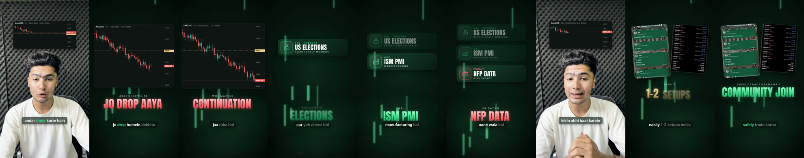
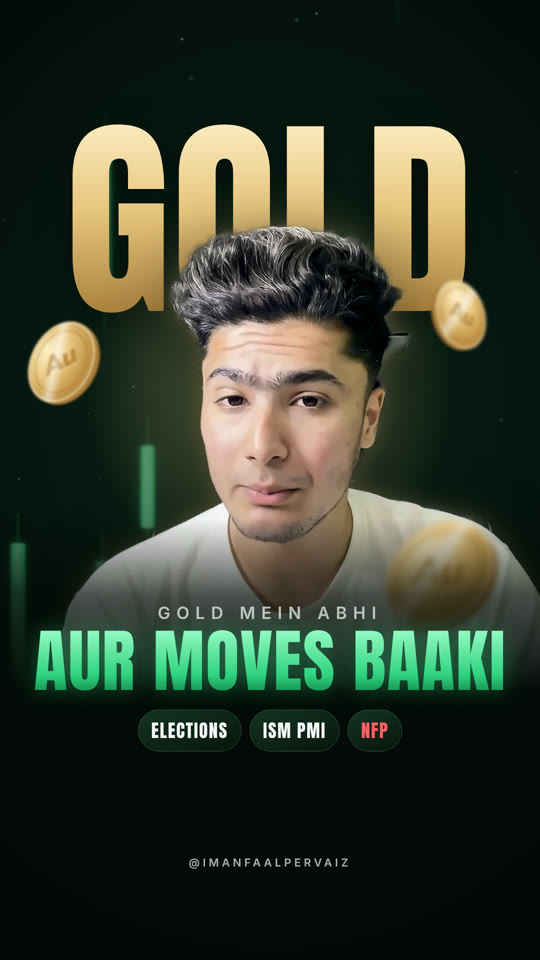

# Forex Premium Motion

The finished reference reel's code is bundled in `assets/template/src/GoldMoves/`:
`design.tsx` (design system), `Reel2.tsx` (the full 74 s reel), `Cover.tsx` (cover still),
`Scenes.tsx` (storyboard compositions: type board, scene stills, hook motion test).
**Copy the folder for each new reel**; change the transcript, timings, scene windows, on-screen cards and assets.
Setup: `assets/template/README.md`.

 

Read first: `references/style.md` (look + motion rules), `references/pipeline.md` (commands, environment fixes).

## Workflow (approval-first: the client asked for this explicitly)

1. **Probe + transcribe** the footage (`pipeline.md` §1–3). Detect real jump cuts (static-background method).
   Track the face; find the clean band for captions (usually above the head on the background).
2. **Storyboard and ASK before building.** Render and send:
   - a **typography board** (3 options on the real footage, `TypeBoard` in `Scenes.tsx`); default is **C**
     (tracked caps lead + Anton keyword) unless the client picks another;
   - **storyboard stills** of every planned scene (hook, each full screen, speaker view, CTA), labelled with times;
   - an **8 s motion test** of the first scene.
   Then ask (AskUserQuestion): typography, motion, which scenes. If the user answers with a message instead,
   follow the message and don't re-ask.
3. **Build** from the template: speaker layer, normal captions, keyword captions, on-screen cards, full screens.
4. **Review** with stills at every scene AND every transition frame (±10 frames around each boundary).
   Fix, then render. Check loudness ≈ −14 LUFS, peak < −1 dB.
5. **Cover**: score frames (`best_frame.py`), send a numbered sheet of 4–6 faces, **let the client pick**, then build
   `Cover.tsx` with that frame. Check the 3:4 grid crop (y 240–1680).
6. Commit/push code; send MP4 + cover with SendUserFile; report briefly.

## Hard rules (every one came from client feedback)

- **Hook stays on camera.** No full-screen motion-graphic hook. Use a chart or info card above the head instead.
- **Normal captions throughout**: full-sentence captions for the whole video (Roman Urdu if spoken Urdu/Hindi),
  centred, word-by-word highlight, key terms in green, soft dark glass pill, balanced 3–4-word lines (no orphan
  words, no overflow). Keyword two-tier lines are extra, never a replacement.
- **Centre alignment** for all type and cards.
- **No text on the face.** Keyword captions + on-screen cards sit in the clean band above the head; normal captions on
  the lower third (pill keeps them readable on light clothes).
- **Real images**: real community screenshots (signals chat, P&L) and real-looking market charts
  (`MarketChart`: TradingView-style dark chart, right price axis, candles, level lines, live price tag). Ask for the
  client's actual chart screenshots; say clearly when a chart is illustrative.
- **Icons** on info cards (ballot = elections, factory = ISM PMI, briefcase = NFP; add simple line icons for others).
- **Motion = glide.** Elements enter on ease-out (18 f), drift gently, exit ease-in (14 f) with blur. **No falling,
  bouncing, tumbling or spring overshoot on shapes.** Camera: slow push ≤ 6 %.
- **No hard cuts**: full-screen ↔ speaker via the light-bloom fog wipe with the layers blurring themselves
  (`fogAt`); speaker jump cuts dissolve from the frozen outgoing frame (8 f) + 4 % zoom settle.
- **Never use CSS `backdrop-filter`** for transitions (headless Chrome mirrors the edges → kaleidoscope glitch).
- Instagram safe zones: nothing important in the top 220 / bottom 380 px; 70 px side margins.
- Colour meaning: green = keyword / bullish / CTA, red = drop / bearish / risk, gold = gold price & XAUUSD only.
- **Music**: never download/rip from YouTube. Ask the client to upload the audio; start it on a beat at the
  timestamp they want (find the nearest onset), level to −30 LUFS for songs with vocals (−29 for instrumentals),
  1.6 s fade-out. Mention Instagram may mute baked-in commercial music.
- **Cover face is the client's choice** (numbered sheet first). Retouch lightly; cut out cleanly (largest blob +
  guided filter, or GrabCut with a trimap when the background touches the body).

## Report

Send files with SendUserFile, then a few lines: what changed, scenes, what to check (transcript words that were
unclear, illustrative charts, screenshots shown), music status, branch.
