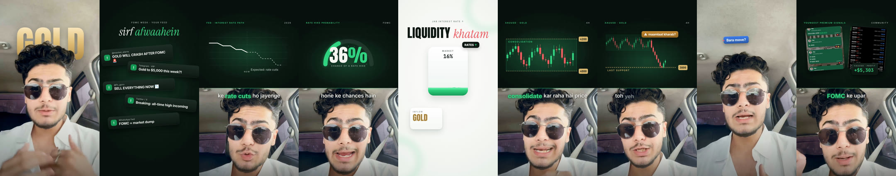
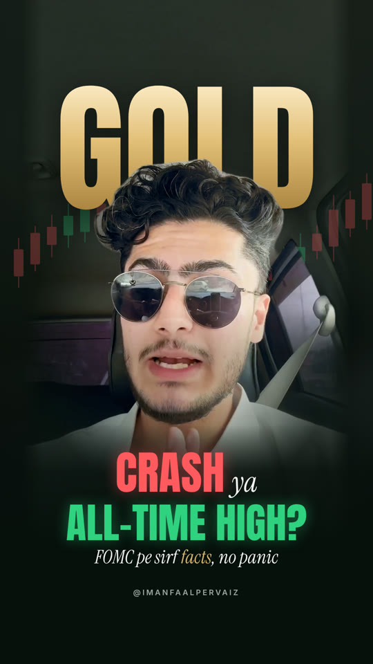

# Forex Trading style

A finished example lives in this repo: `src/Anfaal/` (composition `AnfaalFOMC`, cover still `AnfaalCover`).
**Copy that folder as the template for every new reel**; change `timeline.ts` (cuts, captions, scenes, keywords,
camera, face table), the scene contents and the assets. Don't rebuild the kit.

 

Read before building:
- `references/brand.md`: colours, fonts, type scale, materials, motion, sound (the look).
- `references/pipeline.md`: footage → transcript → cut → grade/denoise → cut-out → face track → render, with the
  exact commands and every environment problem already solved.
- `references/scenes.md`: the scene library (hook, behind-head words, splits, full screens, CTA, cover) and when to use each.

## Workflow

1. **Probe and transcribe** the raw take (`pipeline.md` §1–2). Work out the story in 5 beats: hook (the myth or fear),
   context (Fed / news), mechanism (why price moves), chart (levels), lesson + CTA.
2. **Propose before building**: the cut list (source → cut times, target length, usually 60 s), the scene plan table
   (time · beat · visual) and any assets you need (logo, community screenshots, P&L, portraits). Ask once, briefly,
   then build. If the user says "go", don't ask again.
3. **Build the cut** (`build_cut.py`): best lines only, retakes and pauses out, grade + voice chain baked in.
4. **Cut-out + face track** (`segment_person.py`, `face_track.py`), then fill the `FACE_SEG` table in `timeline.ts`.
5. **Timeline**: captions (Roman Urdu if the speaker speaks Urdu/Hindi, with `*green*`, `!red!`, `^gold^` keywords),
   scene windows, behind-head words, camera keys.
6. **Audio**: `make_audio.py` writes the original music bed + SFX. Never rip copyrighted music (see below).
7. **Verify with stills** at every scene and every keyword moment (`npx remotion still … --scale=0.5`), contact
   sheet them, and check the rules below on each one. Then render, measure loudness, send the MP4.
8. **Cover**: `AnfaalCover` pattern (`scenes.md` §Cover); check the 3:4 grid crop (y 240–1680).
9. Commit + push the code (large footage is git-ignored; scripts regenerate it).

## Hard rules (each one came from client feedback)

- **No text on the face, ever.** Captions, pills, cards and labels go above the head (on the roof/background) or
  are replaced by a behind-head keyword. Place them from the tracked face (`captionTopFull`), never from a guessed y.
  In split screens the speaker's face centre sits at local y 540 of the bottom box, so the caption under the seam
  only covers hair.
- **Never stack two text layers.** Overlays (pills, cards, behind words) and captions take turns: captions hide
  during them (`FULL` list in `Captions.tsx`), and an overlay must finish its exit before the next caption appears.
- Instagram safe zones: nothing important in the top 220 px or bottom 380 px, 70 px side margins.
- Infographics only in split screens (top 960 px) or full screens; the speaker view only gets captions, pills,
  one card or a behind-head word.
- Smooth, not choppy: jump cuts settle (4% zoom + short blur over 0.45 s), camera moves ease in-out, entrances
  ease out (`bezier(0.16,1,0.3,1)`), no bounce. Full-frame zoom ≤ 1.15.
- One accent meaning per colour: green = keyword / bullish / CTA, red = crash / break / loss, gold = gold price and
  XAUUSD levels only.
- **Music**: you can't download or rip a commercial track (YouTube etc.); say so plainly. Ship the original bed from
  `make_audio.py`, and tell the user to add the licensed song in Instagram's music library, or to send their own
  audio file, which you then mix ~15 dB under the voice.
- Real people (e.g. the Fed chair): name and role from a quick web search; use a portrait only if the user
  supplies it or it's an official public-domain portrait. Otherwise use an initials monogram card with an
  `FED_PHOTO` switch.
- Client P&L / signal screenshots: show exactly as supplied, and flag them in the report so the user can opt out.

## Report

Send the MP4 (and cover PNG) with `SendUserFile`, then say in a few lines: what was kept from the raw take, scene
list, what to check (transcript spelling, numbers, screenshots), music status, and the branch.
