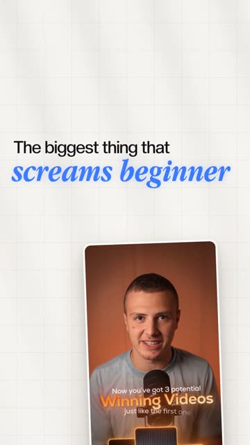
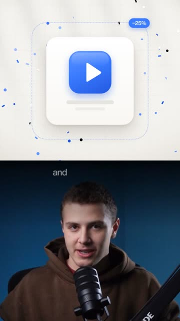
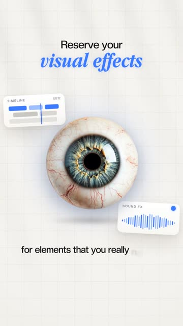
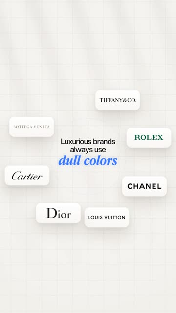

# Scene recipes

Frame numbers assume 30 fps. "Accent", "ink", "ground", "card", "glass" and the fonts all come from the active style profile.

## Contents
Full screen · Half screen · On-screen UI · Captions · Transitions and camera · Worked examples

## Full screen (the payoff visual)

Canvas 1080×1920 (or the requested size). Duration 3 to 6 s.

1. **Ground** (frame 0): profile background, e.g. gradient + grid + casted shadow, or dark gradient + glow.
2. **Reveal in** (0 to 14): circle or square reveal from the previous shot.
3. **Headline** (2 to 30): two-font text in the top third (sans lead-in in ink, special phrase in the accent display font). Word pop / letter pop.
4. **Focal object** (6 to 20): soft pop into the centre zone.
5. **Supporting** (16 to 40): 1 to 3 elements around the focal object, staggered 6 frames.
6. **Snap moment** (about 40 to 70): the one change that makes the point (a value changes, a segment lights up, an object shrinks, a logo swaps).
7. **Depth** (20 to 60): faint pills/particles at the edges, slow float.
8. **Camera** (whole scene): slow zoom-out 1.08 → 1.0, or track the text; optional snap to a new angle at the second beat.
9. **Second line of text** (if the speaker says more): writes on at the bottom third; camera tracks down to it.

Category variants:
- **Text-centric:** the headline is the focal point, set big in the centre; a small object sits beside one word; the camera tracks the words as they write.
- **Object-centric:** the hero object in the centre at about 45% of the width; labels/cards orbit; text above it.
- **Person-centric:** a cut-out or photo card centre or side; a shape/ring/poster behind; name/title in micro labels.
- **Graphic-centric:** a chart, UI card, swatches or logo grid as the focal point; a one-line takeaway above it.

## Half screen (supporting proof)

Top half 1080×960 = the scene; bottom half = the speaker (zoomed about 1.25×, framed on the face) with the caption at the top of the bottom half.

1. The panel slides in from the top (12 frames).
2. One focal element only, centred (cy about 480), smaller than on a full screen.
3. One snap moment (e.g. icon too big → snaps 25% smaller; a 1 of 9 segment lights up; three swatches pop in a row).
4. One accent badge or label at most, plus optional particles.
5. Hold the result about 1 s, then the panel leaves or a cut takes it away.

## On-screen UI (captions + UI)

Over footage; for chapters, steps, lists, sliders, counters, stats the speaker says out loud.

1. The background darkens and blurs in the lower half (10 frames): a dark gradient from about 40% height down, plus backdrop blur 10 to 16 px.
2. The UI card sits in the lower third, centred, at about 75% scale: dark glass (or the profile's UI material).
3. The caption sits directly above the UI.
4. The UI does one thing: a step fills, a slider drags (with a cursor), a number counts, a toggle flips, a checkmark draws.
5. The UI fades out and the background un-blurs as the line ends.

Common UIs: a numbered step tracker (circles + connecting lines; outline in the alert/accent colour for a "mistakes" hook, white fill for chapters), a two-label slider with a knob + cursor, a progress bar with a percentage, a stat card with a count-up, an icon tile row, a notification/toast.

## Captions

- Rows with markup: `These *three mistakes*` / `make your edits look like an amateur`.
- Placement: lower half by default; above the UI when one is shown; top third on full screens; top of the free half on half screens.
- Sans words pop word by word, the display word pops letter by letter; the line lands in under 1.5 s, synced to word times; it blurs out in 6 frames.
- On light grounds the sans switches to ink and the display word stays accent.

## Transitions and camera

| Move | Use | Spec |
|---|---|---|
| Circle reveal | Footage → full screen | clip-path circle 0 → 120% over 14 frames, easeOut |
| Square reveal | Footage → full screen (UI/tech styles) | inset 45% → 0 with radius 60 → 0 over 14 frames |
| Panel slide | Into a half screen | translateY(−100%) → 0, 12 frames |
| Push-in | Talking-head lines | scale 1.0 → 1.06 over the line, in-out |
| Punch-in | Emphasis line | 1.0 → 1.18 in 8 frames, then slow drift |
| Track | Text writes in two places | the camera translates to each text block as it writes |
| Zoom-out + snap | Restart attention | 1.08 → 1.0 slow, then a hard cut to a new angle/scale |

## Worked examples (reference reel, blue-minimal style)

| Scene | Category | Focal | Supporting | Depth | Snap |
|---|---|---|---|---|---|
| "huge icons and huge shape layers" (full) | Text-centric | Headline "screams *beginner*" | Low-quality edit card | none | Camera tracks text top-left → bottom-right |
| "make every element 25% smaller" (half) | Object-centric | App icon card | Dashed old-size outline, −25% badge | Confetti | Icon snaps from too big to −25% |
| "the less you use an effect" (half) | Graphic-centric | 9-segment usage bar | "EFFECT USAGE 1/9" label | none | Only one segment lights blue |
| "reserve your visual effects" (full) | Object-centric | 3D eyeball | TIMELINE card, SOUND FX card | soft shadow | The eye pops and spins |
| "harsh blacks, whites, reds" (half) | Graphic-centric | Three swatch tiles | Names + hex codes | none | Tiles pop one by one |
| "luxury brands use dull colours" (full) | Graphic-centric | Text in the centre | Logo pills orbiting | Faint pills at the edges | Logos fade, new serif text writes on |

   
