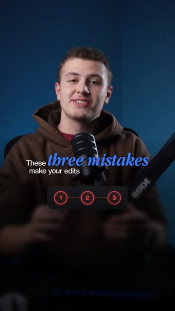
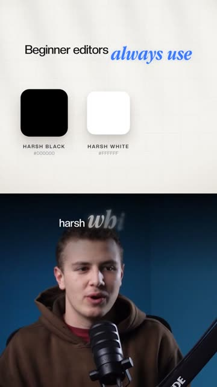

# Style: Blue Minimal (reference reel)

The look of the "3 things from beginner to pro" reel. ReelKit profile: `BLUE_MINIMAL`.

## Colours (3 tones)
- Ground: warm off-white #F4F2EE → #E6E3DE edges, thin grey grid (54 px, 8% ink), soft casted window shadow drifting diagonally
- Ink: #141414 · muted #8B8883
- Accent: #3A7BFF (glow rgba(58,123,255,0.55))
- Footage: dark studio blue; captions #F3F3F3

## Typography
- Sans: Creato Display Medium (free stand-in: Inter 500)
- Display: Apple Garamond Bold Italic (free stand-in: EB Garamond Bold Italic)
- Sizes: 36 px sans / 78 px display at 1080 wide

## Materials
- Cards: white → #F7F6F3 gradient, radius 28 to 64, shadow `0 30px 60px rgba(40,36,30,.14), 0 6px 14px rgba(40,36,30,.08)`, faint inner bottom shadow
- Objects: glossy 3D (eyeball, app icon with a blue gradient + glow)
- UI over footage: dark glass rgba(18,18,22,.72), 1 px rgba(255,255,255,.08) border, radius 26, at 75% scale; lower half darkened 0.7 + blur 14 px

## Motion
- Energy: medium. Circle/square reveals; the camera tracks text, slow zoom-out, snaps to a new angle; slow push-ins on the A-roll; punch-in on emphasis
- Signature UI: a 1-2-3 step tracker (red outline for the "mistakes" hook, white fill per chapter), a Beginner → Professional slider with a cursor

 
